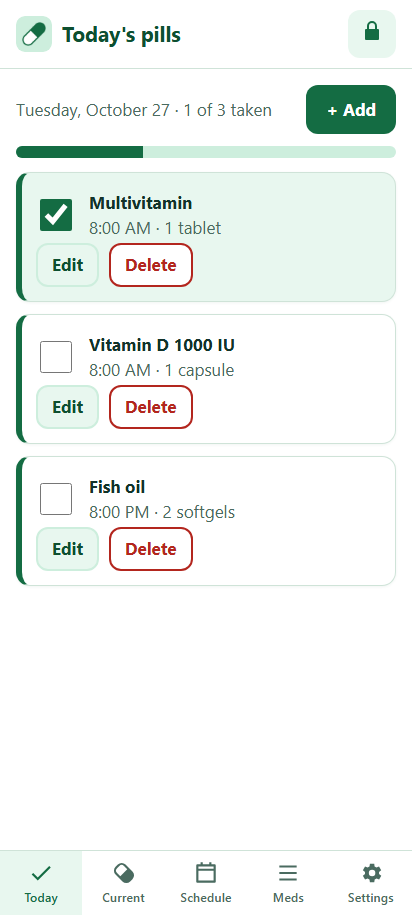
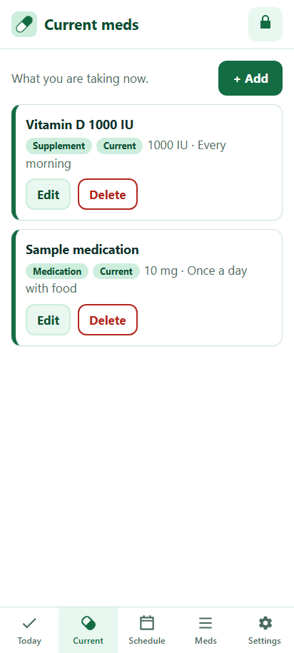
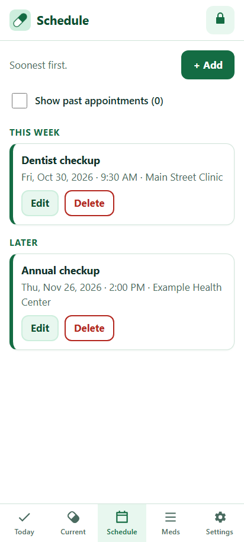
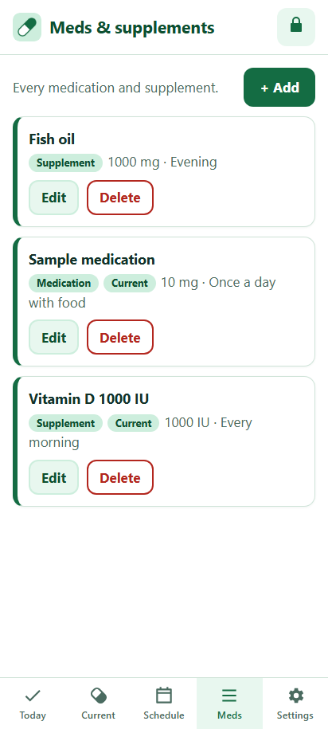
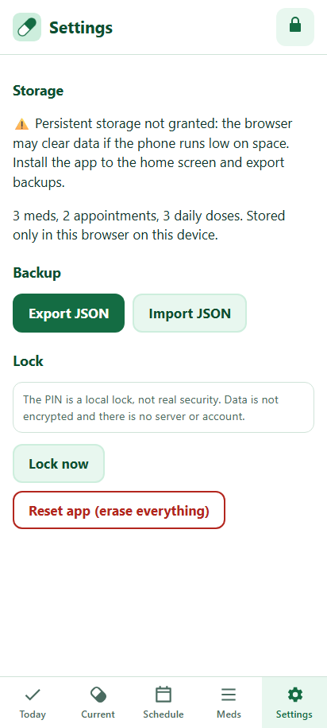

# Care Reminder

A simple medication and care reminder that installs on a phone as a web app (PWA).
Plain HTML, CSS and JavaScript, no build step. All data stays on the device.

## Use it

Live app: https://mogesjohnson.github.io/care-reminder/

On a Samsung Galaxy S23 Ultra, open the link in Chrome, tap the menu, then **Add to Home screen** (or **Install app**). It works offline after the first visit.

Tabs: **Today** (daily pills with check-offs that reset each day), **Current** meds, **Schedule** (appointments soonest first, past ones behind a "Show past" toggle), **Meds** (full list of meds and supplements) and **Settings**. Every list has add, edit and delete.

### Your data

- Everything stays on this device in the browser's local storage. Nothing is sent anywhere, and the app ships empty.
- The app asks the browser for persistent storage and shows on Settings whether it was granted.
- Use **Export JSON** on Settings for backups and **Import JSON** to restore them. Clearing Chrome's site data deletes everything that isn't exported.

### Screenshots

Captured at 412x915 (Galaxy S23 Ultra size) with example data only.

| Today | Current | Schedule | Meds | Settings |
|---|---|---|---|---|
|  |  |  |  |  |

### About the PIN

The PIN is a **local lock, not real security**. It is stored as a salted SHA-256 hash, but the data itself is not encrypted, and anyone with access to the unlocked phone or the browser's storage can read it. If you forget the PIN, **Reset** on the lock screen wipes all data after a confirmation.

### Development

Plain HTML, CSS and JavaScript with no build step. Run `npm test` for the tests. Run `npm run test:e2e` for the headless-Chrome phone check (login, each tab's add/edit/delete, daily reset, export/import, offline service worker); it skips itself when no Chrome is found, and `CHROME_PATH` points it at one. Run `npm run screenshots` to regenerate the README screenshots. Run `python3 tools/make_icons.py` to regenerate the icons (needs Pillow).

## How work flows

This repo follows [BEST-OF-AI-DEV](https://github.com/mogesjohnson/BEST-OF-AI-DEV):

- Every change starts from an issue with acceptance criteria.
- One issue, one branch: `<agent>/<issue>-<topic>` off fresh `main`.
- Conventional Commits (`feat(scope): subject`, at most 72 characters) with `Refs: #N`
  and `Agent: <name>` trailers. No closing keywords; issues close on owner acceptance.
- PRs stay under 600 changed lines. The PR body has Summary (with `Tracking:`), Validation
  (`pass|fail|blocked|not_run: <command>`), Size, Review checklist, and Risks and follow-ups.
- No force-push or history rewrites. Merge only on green checks. The owner allows
  self-merge in this repo.
- Hooks: run `npm install` once per clone. Tests: `npm test`.
